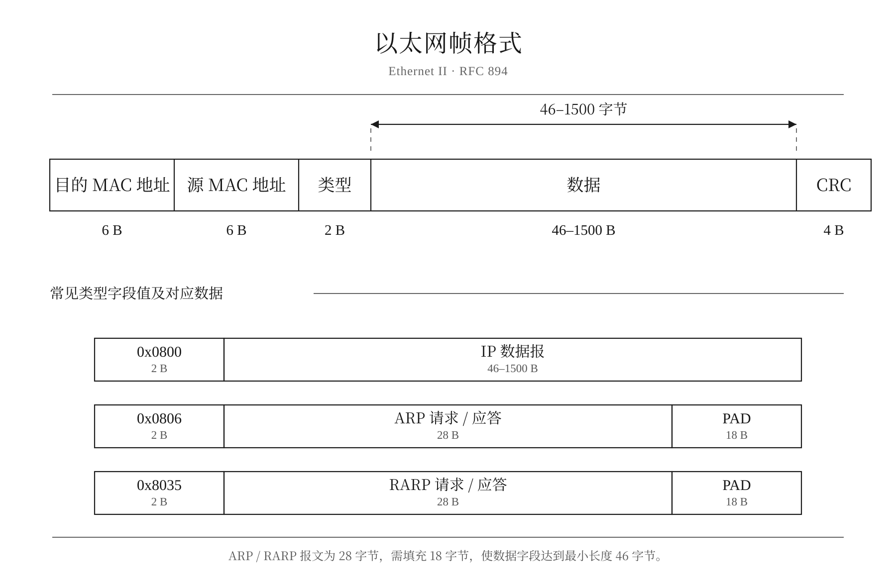
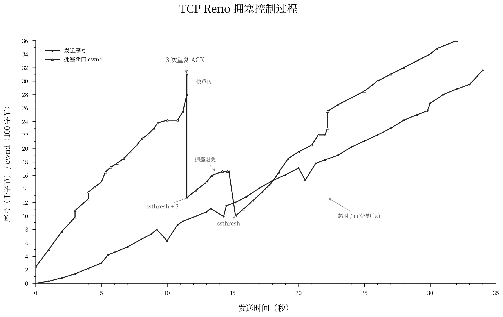

<h1 align='center'>TCP/IP</h1>

<div align="center">
  
  
</div>


## 📚 核心概念

| [链路层](#链路层) | [网络层](#网络层) | [传输层](#传输层) | [应用层](#应用层) |
| ----------------- | ----------------- | ----------------- | ----------------- |

---

## 🎯 目录索引

### 🌐 总览

- [协议栈](#协议栈)
- [数据单元](#数据单元)
- [互联网](#互联网)
- [IP 分类](#ip-分类)
- [分层服务](#分层服务)

### 🔗 链路层

- [协议特性](#协议特性)
- [ARP](#arp)
- [RARP](#rarp)

### 🌍 网络层

- [IP 首部](#首部)
- [路由](#路由)
- [子网](#子网)
- [分片](#分片)
- [选路](#选路)
- [广播和组播](#广播和组播)
- [ICMP](#icmp)
- [Ping](#ping)
- [Traceroute](#traceroute)
- [IGMP](#igmp)

### 🚚 传输层

- [UDP](#udp)
- [TCP 连接](#tcp-连接)
- [三次握手](#三次握手)
- [四次挥手](#四次挥手)
- [TCP 状态机](#tcp-状态机)
- [交互数据流](#交互数据流)
- [成块数据流](#成块数据流)
- [超时与重传](#超时与重传)
- [拥塞控制](#拥塞控制)
- [定时器](#坚持定时器)
- [长肥网络](#长肥网络)

### 📡 应用层

- [DNS](#dns)
- [TFTP](#tftp)
- [BOOTP](#bootp)
- [SNMP](#snmp)
- [Telnet/Rlogin](#telnet-和-rlogin)
- [FTP](#ftp)
- [SMTP](#smtp)
- [NFS](#nfs)

---

<div align="center">
  <a href="#协议栈结构" style="font-size: 1.1em; margin: 0 10px">🚀 协议栈</a> |
  <a href="#tcp" style="font-size: 1.1em; margin: 0 10px">🔍 TCP 专题</a> |
  <a href="#应用层" style="font-size: 1.1em; margin: 0 10px">📡 应用层</a>
</div>


## 协议栈

| 层次 | 协议 |
| :-- | :-- |
| 链路层 | 以太网、802.3、SLIP、PPP \| ARP、RARP |
| 网络层 | IP、ICMP、IGMP |
| 传输层 | TCP、UDP |
| 应用层 | DNS、TFTP、BOOTP、SNMP、Telnet、Rlogin、FTP、SMTP、NFS 等 |


## 概述

### 数据单元

- TCP 段、UDP 数据报、IP 数据报、ARP 分组、以太网帧

### 互联网

- `internet`：用一个共同的协议族把多个网络连接在一起
- `Internet`：世界范围内通过 TCP/IP 互相通信的所有主机集

### IP 分类

```text
8bit . 8bit . 8bit . 8bit
--A--
-----B------
--------C---------
```

- 以上是各类地址的网络号长度

### 概念

- API：`socket`、`TLI`
- 信源 = 发送方，信宿 = 接收方

### 行业简称

- 二层 → 链路层
- 三层 → 网络层
- 四层 → 传输层
- 七层 → 应用层

### 分层服务

- 网络层：提供点到点的服务
- 运输层：提供端到端的服务
- 每个主机的每个接口都有唯一 IP，域名可以映射主机名到 IP 地址，端口号用来标识互相通信的应用程序
- Server 使用知名端口，Client 使用临时端口


## 链路层

### 协议特性

- **广播多路**：以太网、802.3
- **点对点**：SLIP、PPP



#### MTU

- 最大传输单元，指链路层可承载的数据单元长度上限
- 路径 MTU：两台通信主机路径中的最小 MTU

| 网 络                     | MTU字节 |
| :------------------------ | :-----: |
| 超通道                    |  65535  |
| 16 Mb/s 令牌环(IBM)       |  17914  |
| 4 Mb/s 令牌环(IEEE 802.5) |  4464   |
| FDDI                      |  4352   |
| 以太网                    |  1500   |
| IEEE 802.3/802.2          |  1492   |
| X.25                      |   576   |
| 点对点(低时延)            |   296   |

---

### ARP

- ARP 的功能是动态映射 IP 地址到 MAC 地址
- 点对点链路不使用 ARP


#### ARP 高速缓存

- 存放了最近的 IP/MAC 映射，使用 `arp -a` 查看
- 当系统收到 ARP 请求或发送 ARP 应答时，会把请求端的 IP/MAC 存入缓存


#### ARP 分组格式

- ARP 分组的字段围绕“硬件”和“协议”
- ARP 请求里除目的 MAC 外的所有字段都有填充值


#### ARP 请求/应答

- 下一跳需要硬件地址，主机先自查 ARP 缓存，没有则发送 ARP 请求广播目标 IP，目标主机应答自身 MAC


#### ARP 代理

- 同网段但广播域隔离，需要代理应答 ARP
- 开启代理后，本机 MAC 应答该 IP 的 ARP 请求
- `arp -s ip mac pub`：设置强制代理


#### 免费 ARP

- 主机广播自己的 IP 与 MAC，用来检测冲突并通告更新

---

### RARP

- RARP 是许多无盘系统在引导时用来获取 IP 地址的
- RARP 分组的格式与 ARP 分组基本一致，帧类型、`op` 不同


#### RARP 请求/应答

- RARP 请求广播本机 MAC，运行 `rarpd` 的主机应答该 MAC 对应的 IP
- 无盘系统取最先收到的 RARP 应答


## 网络层

### IP


#### 首部

- 大端字节序
- 首部长度字段的单位是 4B
- TOS 字段第 1～4 bit 决定服务类型
- 校验和字段只计算首部（16bit 反码和），路由器的转发会减少 TTL，故 checksum 逐跳校验


#### 选项

##### 记录路由

- 途径路由器记录出口 IP，应答信宿记录入口 IP
- Ping 可启用 RR，观测 IP 数据报对默认路由的使用

##### 源站选路

- 由信源指定途径节点，路由器读取清单，逐跳更新目的 IP 转发
- Traceroute 可启用 LSRR、SSRR 两种策略


#### 路由

- 主机发送数据报，路由器转发
- 路由选择是逐跳进行的，链路层目的地址是下一跳 MAC，但数据报的目的 IP 始终不变


#### 子网

- 子网划分缩减了 Internet 路由表规模
- 子网掩码是网络号与子网号的比特遮罩
- 变长子网允许对子网进行再分，配套子网掩码

> 主机号为 0 时表示一个网段，另外 环回接口：`127.X.X.X`


#### 分片

- IP 根据出站 MTU 分片，终点重组，分片各自独立转发
- 分片信息在 IP 首部第二个 32-bit 字
- 任意分片首次到达，启动重组计时器
- 除末片外，分片数据长度按 8B 对齐
- 传输层首部在首片里，所以首片缺失时无法生成 [ICMP 重组差错](#重组)
- 信源不预分片时，可能交由瓶颈路由器处理

> [ICMP 需分片差错](#需分片)

**UDP 分片-ARP 竞态**

- UDP 触发分片遇 ARP 缓存缺失时，会因邻居未解析队列限制丢包


#### 选路

##### 路由表

- 使用 `netstat -rn` 查看，字段包含目的 IP、下一跳 IP、标志、接口
- Flags：`U`（路由可用）、`G`（网关）、`H`（主机）、`D`（重定向创建）、`M`（重定向修改）
- 5bit 标志，`G` 区分直接路由和间接路由，`H` 区分目的地是主机和网络
- 选路机制：①搜寻匹配 IP ②搜寻匹配网段 ③搜寻默认路由
- 网关即 IP 路由器，默认网关是默认路由的下一跳 IP

> [ICMP 重定向差错](#重定向)，[ICMP 路由器发现](#路由器发现)

##### 动态选路

- 路由守护进程运行于路由器，执行动态选路协议，例如 `routed`、`gated`
- AS：自治系统，是同一管理域的路由器集合
- IGP：内部网关协议，用于 AS 内部选路，代表是 RIP、OSPF
- EGP：外部网关协议，用于 AS 间选路，实际用 BGP

###### RIP

- 选路信息协议，距离-向量 IGP，UDP 封装，端口 520
- 地址族 0，度量 16 代表全路由表请求
- 度量使用跳数，直连 1 跳，最大 15 跳，16 代表不可达
- RIP-1：本地广播全路由表，直连邻居处理
- RIP-2：复用报文保留字段，支持组播

###### OSPF

- 开放最短路径优先，链路-状态 IGP，IP 封装，协议号 89
- 探测邻站链路状态，信息域内扩散，各路由器独立计算得到路由表
- 特性：以接口开销为选路依据，支持等价路由负载均衡；路由通告携带子网掩码，支持主机路由、默认路由；组播

###### AS 拓扑分类

- 残桩 AS、多宿主 AS、转送 AS

###### BGP

- 边界网关协议，路径向量 EGP，TCP 封装
- 与邻居交互路由信息，`keepalive` 报文周期性检测邻站状态
- 对外通告优选路由，支持人工策略干预选路

###### CIDR

- 无类域间路由，又称超网
- 通过路由聚合缩减 Internet 路由表规模，以 32bit 地址 + 掩码运算，摒弃 A/B/C 分类
- 聚合要求：地址高位一致，选路算法、路由协议均支持 32 位掩码
- 选路策略是最长前缀匹配，优选掩码最长的匹配路由


#### 广播和组播

##### 概念

- 广播、组播并非 UDP 专属，属于 IP 层寻址/分发机制
- 单播送至单一主机接口，广播送至本网段全部主机，组播送至已订阅的主机

##### 广播

- **IP**：高位划定域，域后置全 1
- **Mac**：`Mac[47:0] := 1`
- 广播由 IP 层寻址，链路层执行群发投递
- 分为本地广播、定向广播（网络、子网、所有子网）
- 广播开销高，但适合在网段探测未知主机

##### 组播

- **IP**：D 类 IP
- **Mac**：`Mac[40] := 1`，`Mac[22:0] := IP[22:0]`
- 组播面向逻辑主机组分发报文
- 组播地址算法映射，网卡仅粗筛，需要上层终检
- 订阅是临时绑定，跨子网依靠 IGMP 维护组员

---

### ICMP

- ICMP 传递差错与查询诊断信息


#### 查询报文

- 地址掩码应答，返回接收请求接口的子网掩码
- 时间戳请求/应答用于测算往返时延

##### 路由器发现

- 主机启动后广播/组播发送路由器请求，路由器应答，每 10 分钟主动发送通告更新主机路由表
- 通告有效期 30 分钟，超时失效
- 可初始化并动态修改默认路由表项，区别于 `route` 配置的静态路由

##### 回显


#### 差错报文

- 差错报文包含出错数据报的 IP 首部及其后 8B 数据，通常用于获取原数据报的协议、源/目的 IP 和端口等信息，以定位端到端的会话故障
- 差错报文不会再触发新的 ICMP 差错，部分特殊地址报文同样不生成

##### 需分片

- `DF=1` 触发的 ICMP 不可达差错，携带下一跳 MTU
- 点到点链路双向 MTU 允许不同
- 服务于 PMTU-D（路径 MTU 发现机制），发送方置 `DF=1`，依据差错调整 MTU

##### **重定向**

- 默认网关通知主机重定向，修改路由表

##### 重组


#### Ping

- 利用 [ICMP 回显](#回显)请求/应答测试两个 TCP/IP 系统的连通性
- 在 ICMP 报文数据区存入发送时间，以此计算往返时间 RTT
- 首包 RTT 可能因本机 ARP 缓存缺失而偏高


#### Traceroute

- 通过发送 UDP 数据报，自增 TTL 与无效目的端口，接收 ICMP 差错以追踪路由
- **局限性**：
  1. 探测间路由变动造成拼接路径失真
  2. 往返路径不对称导致 RTT 测不准
  3. 非对称路由仅得到单向探测快照

---

### IGMP

- IGMP 由 IP 封装，仅限直连 LAN，不做跨网段路由
- 组播转发表提供候选出口，校验入接口防环，IGMP 按登记状态过滤 LAN 出口
- 使用 `netstat -in` 查看


#### 报告和查询

- 报告：进程选定接口订阅组，内核注册，本机经随机延时、同组抑制后发送报告，路由器登记转发表（IGMPv1 退组不通告）
- 查询：路由器周期性经各接口向 `224.0.0.1` 发出查询，主机复用延时-抑制逻辑应答来更新登记


#### 特殊组 IP

- `224.0.0.0/24`：本地组播，路由器不转发，IP 按标准映射组播 MAC，交换机默认泛洪投递
- `224.0.0.1`：所有主机组，本链路所有启用组播的主机自动订阅，等效 LAN 广播效果


## 传输层

### UDP


#### 数据报

- 进程单次输出生成一个完整 UDP 数据报，交由 IP 封装，不保证可靠性
- 容易触发 ICMP 源站抑制，无原生流量控制，需上层限流（源站抑制为已废弃的历史机制）


#### 首部

- UDP 校验和为可选，报文为奇数字节时本地补 0 参与运算，填充字节不发送，checksum 端到端校验

---

### TCP


- 面向连接、可靠的字节流传输，点对点通信
- 无应用层消息边界，全双工双向传输


#### 连接标识

- Socket：`IP + port`
- Socket Pair：全网唯一标识一条 TCP 连接


#### 首部

- 首部长度单位为 4B
- 校验和机制同 UDP，基于伪首部实现端到端校验


#### 选项

- MSS：单段最大载荷，仅 SYN 协商。一般取 MTU-40，防止本机分片
- 窗口扩大选项，仅 SYN 协商，收发移位因子允许不同


#### 可靠性

1. 应用字节流分段封装
2. 超时重传
3. 延迟确认
4. 端到端校验和
5. 乱序报文重排序
6. 重复报文丢弃
7. 滑动窗口实现双端流量控制


#### TCP 连接

##### 概念

- 确认号：`ack = seq + Data + SYN/FIN`，其中 SYN/FIN 是为了消除确认歧义
- `seq`：同步初始序号，划定单向流序号起点
- MSL：报文最大生存时间

##### 三次握手

```text
C -> S: seq = M                   | SYN
S -> C: seq = N,   ack = M+1      | ACK, SYN
C -> S: seq = M+1, ack = N+1      | ACK
```

##### 四次挥手

```text
C -> S: seq = X,   ack = Y        | ACK, FIN
S -> C: seq = Y,   ack = X+1      | ACK
S -> C: seq = Y',  ack = X+1      | ACK, FIN
C -> S: seq = X+1, ack = Y'+1     | ACK
```

##### TCP 状态机

| 状态 | 本端状态/动作 |
| :-- | :-- |
| `CLOSED` | 无有效连接，无连接上下文 |
| `LISTEN` | 端口绑定，被动监听，等待外部连接请求 |
| `SYN_SENT` | 已发送 SYN，连接上下文已创建 |
| `SYN_RCVD` | 收到对端 SYN，并回复 SYN+ACK |
| `ESTABLISHED` | 本端握手完成，双向收发可用 |
| `FIN_WAIT_1` | 本端已发送 FIN |
| `FIN_WAIT_2` | 本端 FIN 已收到确认 |
| `CLOSING` | 本端已发送 FIN，收到对端 FIN 并回复 ACK，等待本端 FIN 确认 |
| `CLOSE_WAIT` | 收到对端 FIN，回复 ACK |
| `LAST_ACK` | 本端已发送 FIN，等待其确认 |
| `TIME_WAIT` | 所有 FIN 交互完成，等待 2MSL 计时 |

> 本端动作快照

##### 旧连接迟到包处理

- `TIME_WAIT` 等待 2MSL，socket pair 暂不可复用
- TCP 栈重启后 MSL 平静时间内不新建连接

##### 复位报文

- 首包异常 RST 的 `seq=0`
- RST 报文支持异常释放，替代 FIN 无需确认

##### 特殊连接态

- 半关闭：双向独立关闭，停发可收包确认
- 半打开：单端已关闭/异常
- 同时打开：互发 SYN 建立连接
- 同时关闭：互发 FIN，经 CLOSING 转入 TIME_WAIT


#### 交互数据流

##### 延迟 ACK

- 延迟数据确认，优先随反向报文捎带，减少独立确认报文

##### Nagle 算法

- 限一个未确认小段在途，缓存合并发送，抑制小段泛滥


#### 成块数据流

##### 协议首部

- `PSH=1`，通知接收方尽快把数据交付上层，不必填满缓存
- `URG=1`，接收方提示应用优先读取，`seq+ptr` 标记紧急数据末尾序号，读完解除紧急状态
- ACK 累计确认，`ack` 代表此前全部字节已收到

##### 滑动窗口

- 由对端 `ack` 与 `win` 共同界定发送许可区间
- 合拢：左边界右移，收到确认
- 张开：右边界右移，对端缓存释放
- 收缩：右边界左移，通告窗口变小

##### 拥塞窗口

- `cwnd` 是发送方评估的网络承载上限

##### 慢启动

- `cwnd = 1 * SMSS`
- `cwnd += 1 * SMSS` if new ACK


#### 超时与重传

##### 超时重传

- 重传定时器只计时未确认报文，超时重传时 RTO 指数退避
- Karn 算法：重传报文的 ACK 不更新 RTT，持续使用退避 RTO 直到新 ACK 到达

##### 拥塞避免

- `cwnd += SMSS * SMSS / cwnd` if new ACK

##### 拥塞控制



```c++
if new ACK:
    if fast recovery:      cwnd =  ssthresh             // fast recovery(exit)
    elif cwnd < ssthresh:  cwnd += SMSS                 // slow start
    else:                  cwnd += SMSS² / cwnd         // congestion avoidance

if timeout:
    ssthresh = max(FlightSize / 2, 2*SMSS)
    cwnd = SMSS
elif 3 dupACK:                                          // ACK代表报文离开管道，快恢复膨胀响应管道负载下降
    ssthresh = max(FlightSize / 2, 2*SMSS)
    retransmit;                                         // fast recovery(enter)
    cwnd = ssthresh + 3*SMSS
elif fast recovery and dupACK:
    cwnd += SMSS                                        // fast recovery
```


#### 坚持定时器

- 收到零窗口启动坚持定时器，周期性发窗口探查以防连接死锁

##### 糊涂窗口避免

- 接收方：窗口放大增量 `Δ >= MSS` or `Buf/2`
- 发送方：发送数据长度 `len >= SMSS` or `win/2`，或 Nagle 许可/无 Nagle


#### 保活定时器

- 可选机制，检测半打开连接，空闲发包判断连通性


#### 未来和性能

##### 长肥网络

- 带宽时延积大的网络称 LFN，高带宽下时延与窗口是吞吐主瓶颈

##### 性能

- 协议理论上限由约 1GB 窗口与光速约束


## 应用层

### DNS

- 使用倒置分布式域名树，自底向上书写
- 反向解析独立挂载 `in-addr.arpa` 分支

#### 报文

- 默认 UDP，超长或区域传送时切换 TCP，端口 53
- 在资源记录中用偏移指针压缩域名，Question 段不压缩
- `A (TYPE=1)`：域名查 IPv4
- `PTR (TYPE=12)`：反向查询


### TFTP

- 协议结构极简，可固化于 ROM，用于无盘系统引导
- 停-等协议，数据块从 1 编号，逐块 ACK，`ACK(0)` 确认传输许可
- 并发通过每客户分配独立临时端口实现，由 UDP 内核分流

#### 报文

- UDP 封装，端口 69


### BOOTP

- 无盘系统 IP 引导协议，RARP 替代方案，DHCP 技术前身
- 客户端三层本地广播，服务端分配 IP，三层广播应答，二层可选单播/广播，支持跨路由
- DHCP 兼容 BOOTP，使用变长选项并加入租期管理

#### 报文

- UDP 封装，服务端口 67，客户端口 68


### SNMP

- Manager-Agent 架构，用于网管采集设备指标


### Telnet 和 Rlogin

- TCP 远程登录，明文传输，Telnet 支持选项协商


### FTP

- 双 TCP 连接，控制连接持久传命令应答，数据连接临时传文件
- 分主动、被动模式


### SMTP

- TCP 之上，MTA 负责邮件转发


### NFS

- 依托 RPC 与残桩机制，远程访问文件，早期默认 UDP


### 其他应用

- Finger、Whois、Gopher 等早期应用，大多被淘汰
